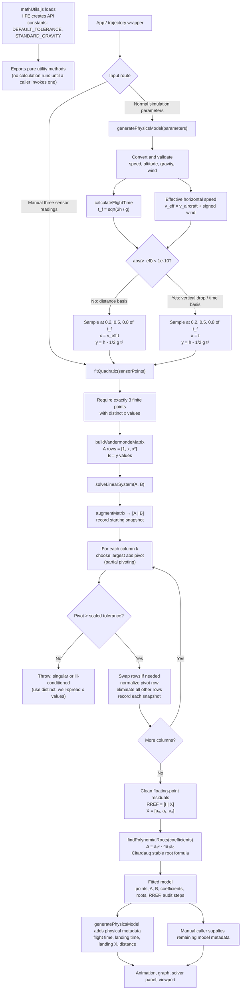
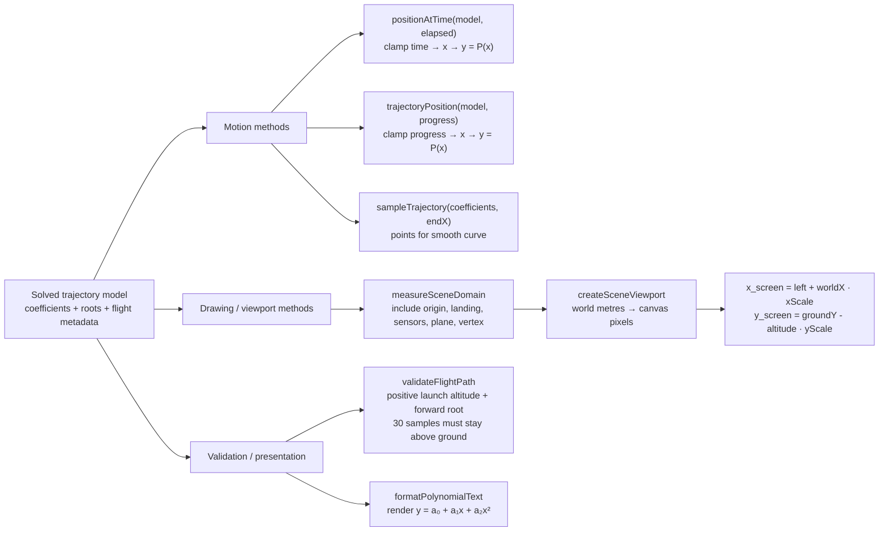

# `mathUtils.js` flow diagram

`js/mathUtils.js` is a pure math module: it does not start an animation or touch the DOM. On load, its wrapper creates the API, makes it available as `TrajectoryMathUtils` in a browser (and `module.exports` in Node), and then waits for another module to call one of its exported methods.

The simulator's main calculation normally starts with `generatePhysicsModel(parameters)`. Manual mode instead starts with `fitQuadratic(sensorPoints)`. Both paths reach the same curve-fitting and linear-system solver.



## Main mathematical pipeline

| Stage | Method(s) | Calculation / result |
| --- | --- | --- |
| Physics setup | `calculateFlightTime`, `calculateEffectiveHorizontalSpeed` | Computes `t_f = sqrt(2h/g)` and `v_eff = v_aircraft ± v_wind`. `generatePhysicsModel` performs these calculations inline for its final model. |
| Physical sample generation | `calculateKinematicPosition` (standalone helper), `generatePhysicsModel` | Uses `x(t) = v_eff t` and `y(t) = h - ½gt²`. The model generator creates samples at 20%, 50%, and 80% of flight time. |
| Quadratic reconstruction | `buildVandermondeMatrix`, `fitQuadratic` | Forms `A X = B`, where `X = [a₀, a₁, a₂]^T` and `y = a₀ + a₁x + a₂x²`. |
| Linear solve | `augmentMatrix`, `cloneMatrix`, `swapRows`, `solveLinearSystem`, `formatNumber` | Reduces `[A | B]` to `[I | X]` with partial pivoting. Every meaningful row operation is copied into `steps` for the UI audit trail. |
| Landing prediction | `findPolynomialRoots` / alias `findPositiveRoot` | Finds real roots of the fitted polynomial. It uses the stable Citardauq form and chooses a forward root; `generatePhysicsModel` selects the root in the physical direction of travel. |

## What happens after the model is solved



`evaluatePolynomial(coefficients, x)` (and its alias `evaluate`) is the shared low-level operation in those downstream paths. It evaluates the curve with Horner form:

```text
P(x) = a₀ + x(a₁ + a₂x)
```

`calculateParabolaVertex` supports scene sizing by finding the curve's peak/valley. The remaining independent helpers support rendering and UI behavior: vector/matrix primitives (`createVector`, `dotProduct`, `matrixVectorMultiply`, etc.), `positiveModulo` for scrolling, `exponentialDecayBlend` for camera smoothing, and `niceScaleTick` for readable ruler intervals.

## Start points at a glance

- **Application startup:** the module only defines constants and returns its public API.
- **Normal simulation:** `app.js` calls the trajectory wrapper's `generatePhysicsModel(parameters)`, which delegates to this file.
- **Manual sensor simulation:** `app.js` calls `fitQuadratic(points)` through the wrapper.
- **Each animation frame:** `positionAtTime(model, elapsed)` calculates the package location; viewport functions project it to pixels.

